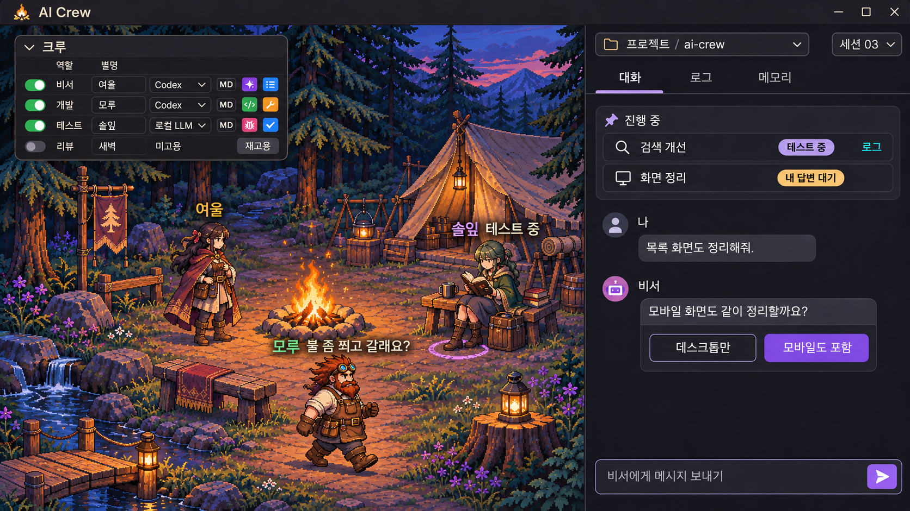

<h1 align="center">AI Crew</h1>

<p align="center">비서 한 명에게 요청하고, 에이전트 팀이 일하는 모습을 픽셀 아트 캠프에서 지켜보는 데스크톱 앱 구상.</p>



## 앱 실행

```sh
npm install
npm start
```

프로젝트 폴더를 열고 비서에게 메시지를 보냅니다. 로컬 LLM은 기본으로 `http://127.0.0.1:8082/v1`에 연결하며 `AI_CREW_LOCAL_URL`과 `AI_CREW_LOCAL_MODEL`로 주소와 모델 ID를 지정할 수 있습니다. 크루에서 역할별로 로컬 LLM 또는 설치된 Codex를 고릅니다. Codex 세션을 다시 열 수 없으면 저장된 대화에서 이어갑니다. 세션과 초안은 앱 데이터 폴더의 SQLite에 저장됩니다. 텍스트 파일 생성·수정·이동을 요청하면 승인 카드에 대상 경로가 표시되고, 세 검증 결과를 업무 로그에서 읽을 수 있습니다.

크루 범례에서 **＋ 팀원**을 눌러 같은 역할의 팀원을 더할 수 있습니다. 별명을 눌러 수정하고, 팀원별로 모델과 고용 상태를 바꿉니다. 비서는 기존 담당자에게 같은 업무를 이어서 맡기고, 새 업무에는 같은 역할의 대기 중인 팀원을 우선 배정합니다.

리뷰 담당이 계획을 확인한 뒤 파일 수정 단계로 넘어갑니다. 비서의 완료 보고에서 **업무 로그**를 열면 검증 결과와 동료 요청을 볼 수 있습니다. 줄 범위가 지정된 검토 의견은 검증 당시의 본문을 보여줍니다. **추가 지시**는 같은 업무를 이어가며 새 계획에 현재 승인 모드를 적용합니다.

동료끼리 필요한 내용을 보완합니다. 사용자 확인이 필요한 질문은 입력창 위에 표시됩니다. 답변하면 비서가 같은 업무의 계획을 갱신하고 현재 승인 모드를 적용합니다.

중단한 업무에서 **이어가기**를 누르면 파일과 저장 기록을 확인합니다. 이미 반영된 변경은 같은 버전에서 남은 검증을 진행하고, 저장 여부가 불명확하면 입력창 위에 확인 질문을 표시합니다.

담당 모델의 연결이 잠시 끊기면 해당 단계에서 최대 세 번 자동 재시도합니다. Codex에 완료된 응답이 남아 있으면 그 결과를 가져옵니다. 모델이 한도를 알리면 비서가 업무를 멈추고 저장한 파일과 남은 단계를 알려줍니다.

“그거 다시 해줘”처럼 앞선 업무를 가리키는 지시는 입력창 위에서 대상을 선택합니다. 원하는 변경이 모호하면 해당 업무에서 바꿀 내용을 다시 묻습니다.

`npm run package`로 데스크톱 앱을 만들고 `npm run check`와 `npm test`로 타입과 저장을 검사합니다. Apple Silicon에서는 로컬 모델을 띄운 뒤 `npm run test:desktop`으로 패키징한 앱의 폴더 선택·세션 복원·도구 호출·파일 승인 흐름을 확인할 수 있습니다.

Codex 프로토콜 타입은 `node scripts/generate-codex-types.mjs`로 현재 설치된 CLI에서 다시 생성합니다.

## 목업 실행

```sh
python3 -m http.server 48723 --bind 127.0.0.1 --directory demo
```

[브라우저에서 열기](http://127.0.0.1:48723/). 대화에서 예시 요청을 골라 보내면 플랜, 개발, 병렬 리뷰·스타일·테스트를 거쳐 결과를 받습니다. 폴더와 승인 모드는 보내기 줄에서, 세션은 상단 ☰에서 고릅니다. 메모리에서 공유 위키와 담당자 기억을 열고, 워크플로우에서 연결점을 끌어 단계 순서를 편집할 수 있습니다.

목업에서는 완성본의 캠프와 워크플로우 편집을 미리 볼 수 있습니다. [제품 구상](docs/concept.md) · [화면과 동작 명세](docs/interaction.md) · [구현 계획](docs/groove/PLAN.md) · [선행 조사](docs/research.md)

## 참고

1. EngChooN, AI Office, 2026. [GitHub](https://github.com/EngChooN/ai-office)
2. Microsoft Research, Agensh: Scaling Organizational Intelligence to 1,024 Agents, 2026. [논문](https://arxiv.org/abs/2609.26781), [코드](https://github.com/microsoft/agensh)
